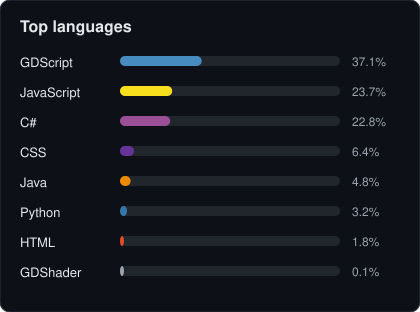

# Hi, I'm Michal 👋

🎓 Computer Science graduate • 🎮 Building games and apps for Android, desktop and the web

I like turning ideas into working software, from mobile games to browser apps. I'm currently building games in three different engines and stacks: Java on Android, Unity with C#, and Godot with GDScript.

---

### 🔧 Tech I work with

---

### 🚀 Featured projects

**🌍 SmallWorld** — A cozy 2D pixel-art RPG built in Godot with GDScript. Mystery story where you wash ashore and uncover the island's secrets, with a procedurally generated map, gradual progression and new places to discover. *In development.*

**🐟 Fish Tank** — A 3D "eat smaller fish and grow" game built in Unity with C#. Low-poly underwater world where you start small and work your way up the food chain. *In development, planned as a free release.*

**🪐 [OrbitConquer](https://github.com/Salateek2/OrbitConquer)** — A Xonix/Qix-style territory-capture game for Android, written in Java. Carve paths across the grid, claim regions, and avoid enemies that threaten your trail. Originally written in 2019 and fully rewritten with a modern architecture (single Activity + Fragments + Navigation, SurfaceView game loop), three enemy types, bonuses and multiple levels. *Headed for Google Play.*

**🏨 Hotel Simulator** — An Android management sim built in Java (Android Studio). Handle guest check-in/out, staff, room building, finances, and random events. Clean layered architecture (model / repository / service / viewmodel / ui) with EventBus. *In development, headed for Google Play.*

**📖 StoryForge** — A browser-based writing tool for fiction authors, built with Vite + React. Chapter tabs, character notes, live word count and reading time, auto-save, and customizable themes. Everything runs client-side.

---

### 📊 GitHub stats

---

### 🐍 Contribution snake

<picture>
  <source media="(prefers-color-scheme: dark)" srcset="https://raw.githubusercontent.com/Salateek2/Salateek2/output/github-snake-dark.svg" />
  
</picture>
